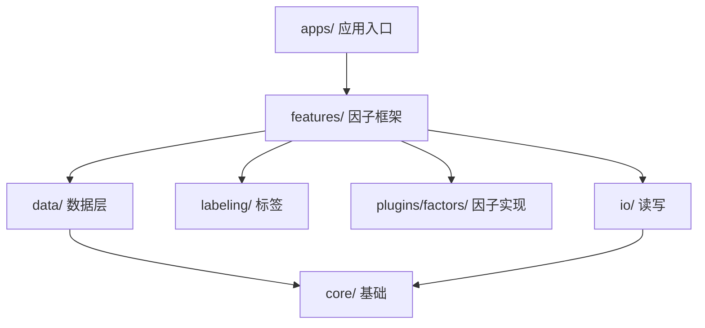
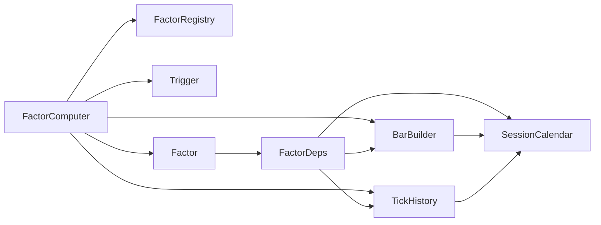
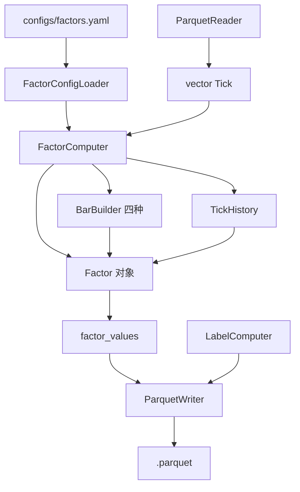
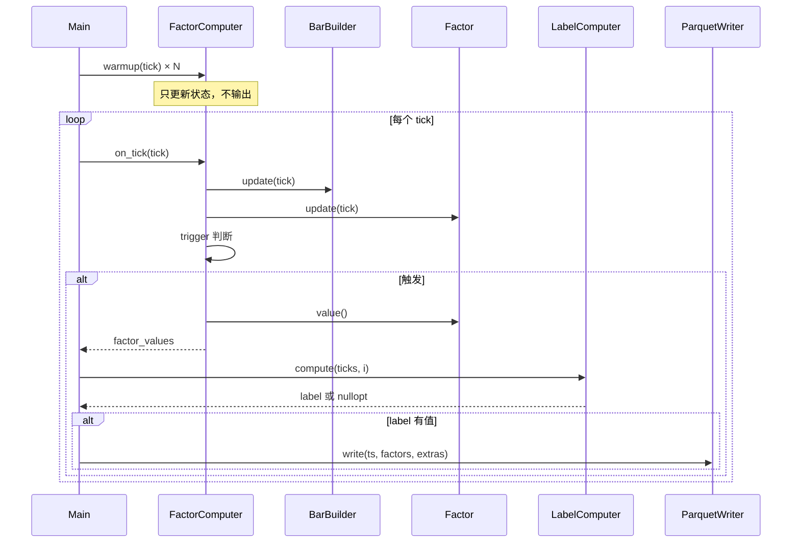

# 因子引擎

一个面向单品种期货的离线因子提取引擎。核心特点是**交易时段感知**、**有状态因子**、**四种 bar**。

配合 Python 研究侧使用：因子探索和模型训练在 Python，因子提取和推理在 C++。

---

## 目录

- [工作流](#工作流)
- [架构](#架构)
- [数据流](#数据流)
- [因子生命周期](#因子生命周期)
- [特色](#特色)
- [适用范围](#适用范围)
- [现有因子](#现有因子)
- [数据准备](#数据准备)
- [数据校验](#数据校验)
- [已知问题](#已知问题)
- [配置说明](#配置说明)
- [扩展指南](#扩展指南)

---

## 工作流

本项目是"**Python 研究 + C++ 生产**"的混合架构：

```
┌─────────────────────────────────────────────────────────┐
│ Python 侧（研究）                                        │
│  1. 原始 CSV → tick parquet（prepare 脚本）              │
│  2. 因子探索、模型训练、回测                              │
│  3. 导出模型文件（linear.txt / lightgbm.txt）            │
└──────────────────────────┬──────────────────────────────┘
                           │
                           ▼
┌─────────────────────────────────────────────────────────┐
│ C++ 侧（生产）                                           │
│  1. tick parquet → 因子 parquet（factor_main）           │
│  2. 加载模型 → 推理 → 信号（predict_main，待实现）        │
└─────────────────────────────────────────────────────────┘
```

**接口约定**：

- `configs/factors.yaml` 是**因子列表的唯一真相**，Python 和 C++ 都读它
- 模型文件里记录训练时的因子名列表，C++ 加载时校验
- 因子计算逻辑以 C++ 为准（Python 侧探索完要移植）

---

## 架构

### 分层



| 层 | 目录 | 职责 |
|----|------|------|
| 应用 | `cpp/apps/` | 读配置、加载 tick、驱动引擎 |
| 框架 | `cpp/features/` | `Factor` 基类、`FactorRegistry`、`FactorComputer` |
| 数据 | `cpp/data/` | session、tick history、bar builder、trigger、price source |
| 标签 | `cpp/labeling/` | 前向收益标签 |
| 因子 | `plugins/factors/` | 具体因子实现（可插拔） |
| IO | `cpp/io/` | Parquet 读写 |
| 推理 | `cpp/inference/` | 模型加载与预测 |
| 基础 | `cpp/core/` | 类型、时间、日志、配置 |

### 模块依赖



**关键约束**：

- 因子**只依赖** `FactorDeps`（calendar / bar_builders / history），不直接依赖 `FactorComputer`
- `BarBuilder` 抽象基类，因子只看到基类接口，不关心是 time/tick/volume/dollar
- `SessionCalendar` 是共享只读的，所有需要时间语义的地方都通过它

---

## 数据流



**处理循环**：



### 输出 parquet

输出的 parquet 包含三类列：

| 类别 | 列 | 说明 |
|------|-----|------|
| 时间 | `timestamp` | 毫秒 |
| 因子 | `factor_*` | 由 `factors.yaml` 定义 |
| 标签 | `forward_return` | 训练用，**回测不能用**（未来函数） |
| 价格 | `last` / `bid1` / `ask1` / `bid_size1` / `ask_size1` / `volume` | 回测用，避免下游和 tick parquet 拼接 |

**价格列是"原子数据"**：`mid` / `spread` 等衍生量让下游自己算，避免冗余。

---

## 因子生命周期

```mermaid
stateDiagram-v2
    [*] --> 构造: FactorRegistry::create(spec, deps)
    构造 --> 预热: warmup(tick)
    预热 --> 预热: update(tick)
    预热 --> 正式: 预热结束
    正式 --> 正式: on_tick → update → value
    正式 --> [*]: 流结束
```

因子对象由工厂创建，构造时注入依赖。`update(tick)` 每 tick 被调用，推进内部状态。`value()` 在触发点被调用，读取当前值。

---

## 特色

### 1. 因子是对象，不是函数

传统做法把因子写成 `(窗口) -> double` 的纯函数。本引擎中因子是**对象**，自己持有状态。

```cpp
class EmaFactor : public Factor {
    double ema_ = 0;
    bool initialized_ = false;

    void update(const Tick& tick) override {
        double p = PriceSource::get(tick, price_type_);
        if (!initialized_) { ema_ = p; initialized_ = true; }
        else ema_ = alpha_ * p + (1.0 - alpha_) * ema_;
    }
};
```

**好处**：

- 递推因子（EMA / RSI / MACD）天然支持，每次 O(1)
- 窗口因子自己管缓冲，不依赖外部传入窗口切片
- 有状态和无状态因子统一接口

### 2. 交易时段感知

`SessionCalendar::adjust_back/forward` 跨休市跳过：

```cpp
// 09:00:00 时，"过去 5 秒" 会跳到前一日夜盘 22:59:55
Timestamp start = calendar_.adjust_back(tick.ts, 5);

// 22:59:00 时，"未来 5 分钟" 会跳到次日 09:04:00
Timestamp end = calendar_.adjust_forward(tick.ts, 5 * 60);
```

这是相比 pandas `df.rolling('5s')` 的核心差异——后者会把休市时间算进窗口。

### 3. 四种 bar

| 类型 | 封口条件 | 用途 |
|------|---------|------|
| Time bar | 时间到了 | 常规 |
| Tick bar | 累计 N 个 tick | 消除"无成交时段"的空 bar |
| Volume bar | 累计 N 手 | 每根 bar 信息量均匀 |
| Dollar bar | 累计 N 元 | 跨品种可比 |

累积型 bar 有**跨 session 强制封口**机制，避免"一根 bar 跨夜盘"。

### 4. 多尺度因子

同一因子在不同 bar 上取值，配置写几遍就行：

```yaml
- name: bar_ret_1min
  base_name: bar_return
  required_bars: [1min]

- name: bar_ret_500tick
  base_name: bar_return
  required_bars: [500tick]

- name: bar_ret_1000vol
  base_name: bar_return
  required_bars: [1000vol]
```

输出三列，作为三个特征。学术界推荐的"多尺度特征"，配置层零成本。

### 5. 分组输出

因子按 `group` 分组：

```yaml
- base_name: price_return
  group: 0
- base_name: price_volatility
  group: 1
```

`FactorComputer` 输出 `factor_groups()`，每组是 `vector<double>`。`LinearModel` 对每组做线性预测，再 PCA 组合。这是"分组 stacking"结构。

### 6. 插件式因子

新因子只需要三步：

1. 写一个继承 `Factor` 的类
2. 在 `register_all.cpp` 里注册工厂
3. 在 `factors.yaml` 里加一行配置

不需要改 `FactorComputer` 或引擎核心。

---

## 适用范围

### 能覆盖

**单品种、因果、流式**（逐 tick 或逐 bar）的量价因子：

| 类型 | 例子 |
|------|------|
| 递推 | EMA、RSI、MACD、ATR、ADX |
| 窗口 | MA、滚动方差、z-score、极值位置 |
| 盘口 | spread、size imbalance、5 档不平衡、WAP |
| tick 聚合 | 窗口成交量、VWAP、tick 数 |
| bar 聚合 | 时间 bar / tick bar / volume bar / dollar bar |
| tick + bar 交互 | bar 收益 × 盘口不平衡 |
| 时间 | 距开盘秒数、session 内位置 |
| 因子组合 | 少量内部重算，多量上 DAG |

### 不能覆盖

| 类型 | 归属 |
|------|------|
| 非因果因子（用了未来数据） | `LabelComputer` 或离线批处理 |
| 多品种联合因子（跨合约价差、协整） | 独立模块 |
| 整段批处理因子（Hurst、分形维数） | 离线通道 |
| 需要对齐多个 tick 流的因子 | 数据对齐层 |

---

## 现有因子

| 类别 | 因子 | 说明 |
|------|------|------|
| 价格 | `price_return` | 窗口首尾价格的对数差 |
| 价格 | `price_volatility` | 窗口内收益的标准差 |
| 价格 | `max_price_to_now` | 最高价在窗口中的位置 |
| 价格 | `price_slope` | 价格线性回归斜率 |
| 价格 | `price_range` | 窗口内最高-最低 |
| 盘口 | `price_spread` | bid1/ask1 对数差 |
| 盘口 | `volume_balance` | 五档买卖不平衡 |
| 盘口 | `price_versus_mid` | last 相对 mid 的偏离 |
| 成交量 | `total_volume` | 窗口内成交量总和 |
| 成交量 | `oi_change` | 持仓量对数变化 |
| 递推 | `ema` | 指数移动平均 |
| bar | `bar_return` | 相邻两根已封口 bar 的收益 |
| bar | `bar_acc` | bar 的累积量（tick 数 / 成交量 / 成交额） |
| bar | `bar_tick_density` | bar 内 tick 密度 |

---

## 数据准备

原始 CSV → tick parquet：

```powershell
python python/scripts/prepare_tick_to_parquet.py `
    data/raw/raw_0min_SHFE.ao2701.csv `
    data/ticks `
    --instrument AO2701 `
    --prefix SHFE.ao2701
```

**关键处理**：

- 时间戳转 int64 毫秒
- **volume 转增量**：数据源是累计值，必须转。做法是按**累计值重置点**分组，`groupby("trading_day_id").diff()`
- 盘口异常过滤（`bid1 >= ask1` 丢弃）
- 按**自然日**分片（一天一个 parquet）

**注意**：自然日分片意味着**跨交易日的夜盘会被拆到两个文件**。例如 9-4 夜盘 21:00~23:00 在 `20260904.parquet`，23:00~01:00 在 `20260905.parquet`。**这是正常的**，引擎处理无影响。

### volume 语义

引擎**假设 `Tick::volume` 是增量**（每 tick 成交了多少手）。

- **数据源**：期货数据源（TqSdk、CTP）通常给**累计值**
- **转换位置**：**应用层**（数据准备脚本 / 实盘行情回调）
- **引擎内部**：始终看到增量

**实盘接入时**：应用层负责转换，逻辑要和 `prepare_tick_to_parquet.py` 一致。

---

## 数据校验

改完引擎后，跑对齐检查：

```powershell
python python/scripts/check_price_columns.py `
    data/features/ao2701_train.parquet `
    data/ticks/AO2701 `
    20260902 20260930
```

**校验内容**：

- `last` / `bid1` / `ask1` / `bid_size1` / `ask_size1` / `volume` 是否和 tick parquet 一致
- 盘口合理性（`bid1 < ask1`）
- `last` 是否落在 `[bid1, ask1]` 内

**预期**：

- 6 列全部 OK
- `bid1 < ask1` 全部满足
- `last` 越界比例 < 1%（真实市场现象，不是 bug）

---

## 已知问题

### 1. `adjust_back` 在跨休市时慢

**现象**：跨休市后几行 `last_10000_ms` 从 20ms 飙到 5000ms。

**原因**：每 tick 每个窗口因子调用一次 `adjust_back`。跨休市时内部 while 循环迭代多次。

**影响**：只影响跨休市后的少数 tick，整体耗时可控。

**可选优化**：缓存同一 tick 的 `adjust_back` 结果，或改用二分。

### 2. 无参数校验

`factors.yaml` 里 `base_name` 写错，运行时抛异常，没有编译期校验。

**改进**：加载配置时预检查所有 `base_name` 是否已注册。

### 3. `TickHistory` 目前未被因子使用

接口已预留，当前因子都自己持有 `deque` 或用 `BarBuilder`。`TickHistory` 只在 `FactorComputer::update_all` 里 push，没人读。

**用途**：将来做"滞后因子"（回看第 k 个 tick）时会用到。

### 4. session 边界的小 bar

`bar_acc` 在 session 边界会出现小值（如 1、58、318），这是因为**跨 session 强制封口**导致的。

**现象**：约 2.7% 的行 `bar_acc_1000vol < 500`。

**原因**：上一段 session 结束时 bar 没累积到阈值，跨 session 时被强制封口。

**语义正确**：bar 确实只累积了那么多。**不是 bug**。

**下游处理**：如果模型需要，可以额外输出 `bar_span_ms` 或 `bar_tick_count` 让模型识别"完整 bar"和"跨 session 小 bar"。

### 5. warmup 不保证收敛

`warmup_ticks = 10000` 是经验值。数据密度变化大时，10000 tick 覆盖的时间跨度差异大，EMA 收敛程度不一。

**当前数据验证**：9-1 有 47000 tick，warmup 10000 足够。

---

## 配置说明

### `pipeline.yaml`

```yaml
instrument: AO2701
factor_config: configs/factors.yaml
label_config: configs/labels.yaml
start: "2026-09-02 09:00:00"
end: "2026-09-30 09:05:00"
output: data/features/ao2701_train.parquet
```

### `factors.yaml`

顶层分四块：触发、warmup、bar、因子。

```yaml
trigger_type: every_tick       # every_tick / time
warmup_ticks: 10000

bars:
  - name: 1min
    type: time
    period_seconds: 60
  - name: 500tick
    type: tick
    ticks_per_bar: 500
  - name: 1000vol
    type: volume
    volume_per_bar: 1000
  - name: 500kdollar
    type: dollar
    dollar_per_bar: 500000

factors:
  - base_name: price_return
    window_seconds: 3
    price_type: mid
    group: 0

  - name: bar_ret_1min
    base_name: bar_return
    required_bars: [1min]
    group: 3
```

**字段**：

| 字段 | 说明 |
|------|------|
| `base_name` | 工厂 key，必须已注册 |
| `name` | 输出列名，省略则等于 `base_name` |
| `required_bars` | 依赖的 bar 名字列表 |
| `window_seconds` | 按时间窗口（秒） |
| `window_ticks` | 按 tick 数窗口 |
| `price_type` | last / mid / wap / bid1 / ask1 |
| `params` | 因子自定义参数 |
| `group` | 输出分组 |

### `labels.yaml`

```yaml
name: forward_return
horizon_minutes: 5
price_type: mid
```

### `instruments/ao2701.yaml`

```yaml
instrument: AO2701
exchange: SHFE
tick_size: 1.0
multiplier: 20
trading_day_cutoff: "21:00"
sessions:
  - { start: "00:00", end: "01:00" }
  - { start: "09:00", end: "10:15" }
  - { start: "10:30", end: "11:30" }
  - { start: "13:30", end: "15:00" }
  - { start: "21:00", end: "24:00" }
```

**注意**：夜盘定义拆成两段（`21:00~24:00` 和 `00:00~01:00`），因为 `SessionCalendar` 按 `hhmm` 判断，不支持跨自然日的单段。

---

## 扩展指南

### 加一个因子

**1. 写因子类**（`plugins/factors/xxx.cpp`）：

```cpp
#include "features/factor.h"

namespace hft {
    namespace factors {

        namespace {

            class MyFactor : public Factor {
            public:
                MyFactor(std::string name, int param)
                    : name_(std::move(name)), param_(param) {}

                const std::string& name() const override { return name_; }
                void update(const Tick& tick) override { /* 推进状态 */ }
                double value() const override { /* 返回值 */ return 0.0; }
                void reset() override { /* 清状态 */ }

            private:
                std::string name_;
                int param_;
            };

        }

        void register_my_factors() {
            register_factor("my_factor",
                [](const FactorSpec& s, const FactorDeps& d)
                -> std::unique_ptr<Factor> {
                    int param = s.params.empty() ? 0 : static_cast<int>(s.params[0]);
                    return std::make_unique<MyFactor>(s.name, param);
                });
        }

    }
}
```

**2. 注册**（`register_all.cpp`）：

```cpp
void register_my_factors();

void register_all() {
    // ...
    register_my_factors();
}
```

**3. 配置**（`factors.yaml`）：

```yaml
- name: my_factor_10
  base_name: my_factor
  params: [10]
  group: 0
```

### 加一种 bar

继承 `AccumulatingBarBuilder`，实现 `accumulate`：

```cpp
class MyBarBuilder : public AccumulatingBarBuilder {
public:
    MyBarBuilder(const std::string& name, double threshold, size_t max_bars)
        : AccumulatingBarBuilder(name, threshold, max_bars) {}

    double accumulate(const Tick& tick) const override {
        return /* 本 tick 累加多少 */;
    }
};
```

然后在 `FactorComputer` 构造函数里加一个 `type` 分支。

---

## 一句话总结

**面向单品种期货、以交易时段为语义基础、支持有状态因子和四种 bar 的离线因子引擎。** 优势是递推因子、交易时段感知、多尺度 bar；边界是单品种、因果、流式。